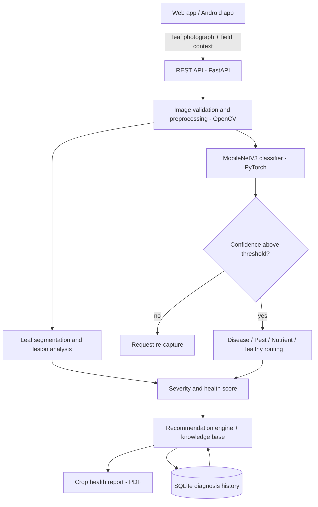
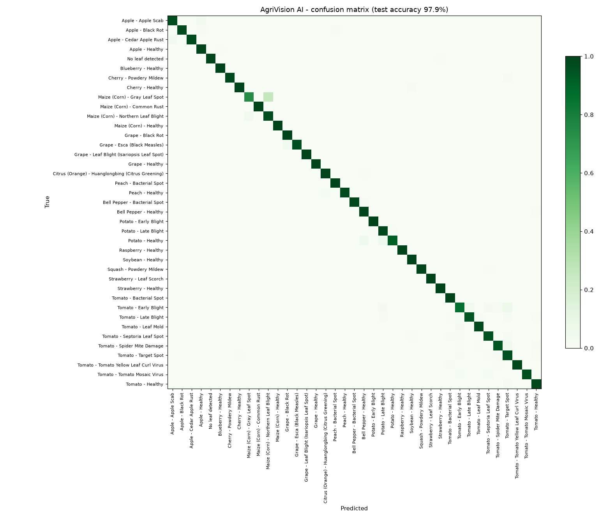
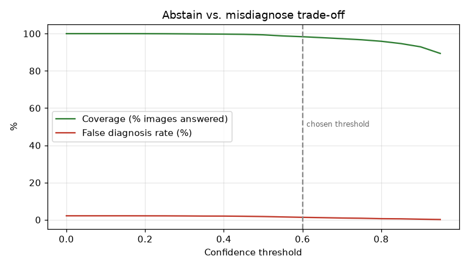

# AgriVision AI

**AI-Powered Crop Health Monitoring and Failure Diagnosis**

AgriVision AI diagnoses crop diseases, pest damage and nutrient deficiencies from a single photograph
of a leaf. For every image it reports the probable cause, the model's confidence, a severity level and a
0–100 crop health score, and generates context-aware treatment recommendations and a PDF crop-health
report. The system is available as a web application, a REST API and an Android application.

| | |
|---|---|
| **Project** | Minor Project, B.Tech |
| **Team** | Akshata Bakre (23118007), Himanshu Kashyap (23118043) |
| **Guide** | Dr. Sanjay Kumar |

---

## Contents

1. [Problem Statement](#problem-statement)
2. [Key Features](#key-features)
3. [System Architecture](#system-architecture)
4. [Methodology](#methodology)
5. [Results](#results)
6. [Technology Stack](#technology-stack)
7. [Repository Structure](#repository-structure)
8. [Installation](#installation)
9. [Usage](#usage)
10. [Training and Evaluation](#training-and-evaluation)
11. [Limitations and Future Work](#limitations-and-future-work)
12. [References](#references)

---

## Problem Statement

Crop problems are usually identified only after visible damage has become severe. Diseases, nutrient
deficiencies and pest attacks often produce similar symptoms, access to agricultural experts is limited,
and manual field inspection is slow. Late or incorrect diagnosis leads to improper treatment, reduced
yield and financial loss.

AgriVision AI addresses this with an early-screening tool: a farmer photographs an affected leaf and
receives a diagnosis, a severity estimate and actionable next steps within seconds, without waiting for
an expert visit.

## Key Features

- **Image-based diagnosis** across 14 crops and 38 crop conditions, plus rejection of images that do not
  contain a leaf.
- **Four-way routing** of every image into *Disease*, *Pest*, *Nutrient deficiency* or *Healthy*, with a
  probability for each category.
- **Severity estimation** from the proportion of damaged leaf tissue, expressed as a 0–100 health score
  and a band: Healthy (90–100), Mild (70–89), Moderate (40–69), Severe (0–39).
- **Nutrient-deficiency screening** for nitrogen, potassium and iron/magnesium based on leaf colour
  patterns.
- **Context-aware recommendations** that take into account crop, severity, growth stage, temperature,
  humidity, soil moisture, soil pH, region and the field's diagnosis history (recurring outbreaks are
  escalated).
- **Calibrated confidence with abstention**: when the model is not confident enough, the system asks for
  a new photograph instead of recommending a treatment.
- **Explainable output**: the detected leaf region and a colour-coded map of necrotic, chlorotic and
  powdery tissue are shown with every result.
- **Crop-health reports** in PDF format and a per-field diagnosis history.
- **Three interfaces**: Streamlit web application, FastAPI REST API and a native Android application.

## System Architecture



## Methodology

### Datasets

| Dataset | Images used | Description |
|---|---|---|
| PlantVillage | 15,131 (up to 400 per class) | Laboratory photographs on plain backgrounds; 38 crop-condition classes and a background class |
| PlantDoc | 2,578 | Real field photographs with natural backgrounds and lighting, mapped to 28 of the PlantVillage classes |

PlantVillage is split 70 / 15 / 15 into training, validation and test sets with stratification by class.
PlantDoc's official test split is kept aside as an independent field-photo test set. Corrupt and
unreadable images are removed during preparation.

### Image Preprocessing

1. **Validation**: minimum resolution, blur (variance of the Laplacian), under- and over-exposure, and
   presence of a leaf region.
2. **Enhancement**: contrast-limited adaptive histogram equalisation (CLAHE) for dark images.
3. **Leaf segmentation**:
   - *Plain background*: saturation and excess-green thresholding, with pixels matching the
     background colour (estimated from the image border) removed.
   - *Field photographs*: GrabCut seeded with plant-coloured pixels that are in focus, exploiting the
     fact that the photographed leaf is sharp while the background foliage is blurred.
4. **Normalisation**: resizing to 224 × 224 and ImageNet mean/standard-deviation normalisation.

### Classification Model

- **Backbone**: MobileNetV3-Large pre-trained on ImageNet, chosen for its low computational cost and
  suitability for mobile and edge deployment.
- **Transfer learning by feature extraction**: the backbone is frozen and every training image is passed
  through it once to obtain a 1280-dimensional embedding. A classification head (one hidden layer of
  512 units, ReLU, dropout) is trained on the cached embeddings. This keeps training feasible on a
  CPU-only machine.
- **Training**: AdamW optimiser, cosine learning-rate schedule, label smoothing, early stopping on the
  mean of laboratory and field validation accuracy. Field photographs are oversampled and mirrored.
- **Calibration**: temperature scaling on the validation set, so that reported confidence reflects the
  actual probability of being correct.

### Abstention

A wrong treatment recommendation is more harmful than a request for another photograph. The system
therefore abstains below a confidence threshold: 0.60 for plain-background images and 0.73 for field
photographs. The field threshold is selected automatically on the field validation set to keep the false
diagnosis rate at or below 20%.

### Severity Estimation

Within the segmented leaf, pixels are classified in HSV colour space as healthy green, chlorotic
(yellow), necrotic (brown/dark) or powdery (white). The damaged fraction *a* is mapped to a health score
of 100 · (1 − *a*)^1.6. Diseases that are aggressive or systemic (late blight, viral diseases, citrus
greening) carry a minimum severity level regardless of the visible lesion area.

### Nutrient-Deficiency Screening

Rule-based colour-pattern analysis applied to leaves the classifier considers disease-free:

| Pattern | Indicated deficiency |
|---|---|
| Uniform yellowing across the leaf | Nitrogen (N) |
| Yellow/brown damage concentrated at the leaf margin | Potassium (K) |
| Yellow lamina with green veins (interveinal chlorosis) | Iron (Fe) or Magnesium (Mg) |

Results are presented as probable and are always accompanied by a recommendation to confirm with a soil
or tissue test before applying fertiliser.

### Recommendation Engine

A knowledge base (`agrivision/knowledge_base.json`) holds, for every class, the cause, typical symptoms,
cultural actions, treatment options, prevention measures and the environmental conditions that favour
the pathogen. The engine combines this with:

| Factor | Effect on the recommendation |
|---|---|
| Severity | Mild: monitor and re-check; Moderate: treat this week; Severe: act immediately and inspect the whole field |
| Temperature and humidity | Warns when current conditions favour spread and escalates treatment |
| Growth stage | Seedling, flowering and fruiting-specific precautions (e.g. pre-harvest interval) |
| Soil moisture and pH | Supporting evidence for pest stress and Fe/Mg deficiency |
| Diagnosis history | The same problem in the same field within 30 days is flagged as a recurring outbreak |
| Region | Reminder to use only locally approved products |

## Results

### Laboratory photographs (PlantVillage test set, 2,270 images, 39 classes)

| Metric | Value |
|---|---|
| Accuracy | **97.0%** |
| Macro precision / recall / F1-score | 0.970 / 0.970 / 0.970 |
| Category routing accuracy (disease / pest / healthy / not a leaf) | 98.9% |
| False diagnosis rate without abstention | 3.0% |
| False diagnosis rate at confidence threshold 0.60 | **1.8%** (97.2% of images answered) |

### Field photographs (PlantDoc test set, 236 images, 28 classes)

| Metric | Value |
|---|---|
| Accuracy of a model trained on laboratory images only | 19.9% |
| Accuracy of the final model (laboratory + field training) | **53.8%** |
| Top-3 accuracy | 73.7% |
| Category routing accuracy | 89.8% |
| False diagnosis rate at confidence threshold 0.73 | 27.7% (55.1% of images answered) |

Adding field photographs to training improved accuracy on real-world images by a factor of 2.7 while
maintaining laboratory accuracy. The gap between the two test sets shows that models trained only on
controlled laboratory images do not transfer directly to field conditions.

### Confusion matrix and abstention trade-off

| Confusion matrix (laboratory test set) | Coverage vs. false diagnosis rate |
|---|---|
|  |  |

Complete per-class metrics are available in [`models/metrics.json`](models/metrics.json).

### Computational cost

| | |
|---|---|
| Hardware | Intel Core i5-1035G1, 8 GB RAM, no GPU |
| Feature extraction (one-time) | ≈ 10 minutes |
| Classifier training | ≈ 3 minutes |
| Inference | < 2 seconds per image, including segmentation |
| Model size | 19.7 MB |

## Technology Stack

| Layer | Technology |
|---|---|
| Computer vision | OpenCV, Pillow, NumPy |
| Machine learning | PyTorch, torchvision (MobileNetV3-Large), scikit-learn |
| Backend | Python, FastAPI, Uvicorn |
| Web frontend | Streamlit |
| Mobile application | Kotlin, Jetpack Compose, OkHttp (Android 9 and later) |
| Database | SQLite |
| Reporting | fpdf2, Matplotlib |

## Repository Structure

```
agrivision/                 core package
  config.py                 paths, thresholds and severity bands
  preprocessing.py          image validation, enhancement, leaf segmentation, lesion maps
  model.py                  MobileNetV3 backbone, classification head, inference
  pipeline.py               end-to-end diagnosis workflow
  severity.py               damaged-area analysis and health score
  nutrient.py               nutrient-deficiency screening
  recommender.py            recommendation engine
  knowledge_base.json       disease, pest and nutrient knowledge base
  database.py               SQLite diagnosis history
  report.py                 PDF report generation
scripts/
  prepare_data.py           PlantVillage sampling, cleaning and splitting
  add_field_data.py         PlantDoc field-image preparation and label mapping
  train.py                  feature extraction, head training, calibration
  evaluate.py               metrics, confusion matrix, abstention analysis
  smoke_test.py             end-to-end test of the pipeline, reports and API
  ui_test.py                automated test of the web interface
android/                    Android application source code
models/                     trained model, metrics and evaluation plots
samples/                    example images from the held-out test set
app.py                      Streamlit web application
api.py                      FastAPI REST API
serve_mobile.py             API launcher for the Android application
AgriVision.apk              Android application package
```

## Installation

**Requirements:** Python 3.10 or later. No GPU is required.

```bash
git clone https://github.com/akshatabakre/agrivision-ai.git
cd agrivision-ai

python -m venv .venv
# Windows
.venv\Scripts\activate
# Linux / macOS
source .venv/bin/activate

pip install torch torchvision --index-url https://download.pytorch.org/whl/cpu
pip install -r requirements.txt
```

The trained model is included in the repository (`models/agrivision_mobilenetv3.pt`), so the
application can be used immediately without retraining.

## Usage

### Web application

```bash
streamlit run app.py
```

Open http://localhost:8501, upload or capture a leaf photograph (or select one of the bundled samples),
optionally enter the field context, and select **Analyse crop**. The *Field history* tab shows past
diagnoses and health-score trends; the *Model performance* tab shows the evaluation results.

### REST API

```bash
uvicorn api:app --port 8000
```

Interactive documentation is available at http://localhost:8000/docs.

| Method | Endpoint | Description |
|---|---|---|
| `POST` | `/analyze` | Diagnose an uploaded image; optional form fields: crop, field, region, growth stage, temperature, humidity, soil moisture, soil pH |
| `GET` | `/history` | List previous diagnoses (optionally filtered by field) |
| `GET` | `/diagnoses/{id}` | Retrieve a stored diagnosis |
| `GET` | `/report/{id}` | Download the PDF crop-health report |
| `GET` | `/crops` | List supported crops |
| `GET` | `/health` | Service status |

### Android application

The Android application connects to the API running on a computer on the same local network, for
example a laptop connected to the phone's mobile hotspot.

1. On the computer, start the server for mobile clients:
   ```bash
   python serve_mobile.py
   ```
   The command prints the address to use, for example `http://192.168.43.20:8000`.
   On Windows, `START_MOBILE_SERVER.bat` does the same. The firewall must allow incoming connections
   to Python on port 8000.
2. Install `AgriVision.apk` on an Android phone (Android 9 or later).
3. In the application, open **Settings**, enter the server address and select **Save & test connection**.
4. Use the **Diagnose** tab to photograph or select a leaf image.

To build the application from source, JDK 17 and the Android SDK (API level 35) are required; see
`android/build_apk.bat`.

## Training and Evaluation

The datasets are not stored in the repository because of their size. To reproduce the model:

1. Download the PlantVillage dataset ("Plant leaf diseases dataset without augmentation", Mendeley
   Data) to `data/plantvillage.zip`.
2. Download the PlantDoc dataset repository archive to `data/plantdoc.zip`.
3. Run:

```bash
python scripts/prepare_data.py --per-class 400   # sample, clean and split PlantVillage
python scripts/add_field_data.py                 # prepare PlantDoc field photographs
python scripts/train.py                          # extract features, train, calibrate, evaluate
```

Additional options: `python scripts/train.py --reuse` retrains the classifier from cached features,
and `python scripts/evaluate.py` recomputes the metrics only.

Automated tests:

```bash
python scripts/smoke_test.py    # pipeline, PDF reports and REST API
python scripts/ui_test.py       # web interface
```

## Limitations and Future Work

**Limitations**

- Accuracy on field photographs (53.8%) is substantially lower than on laboratory images (97.0%).
  The system compensates by abstaining on uncertain field images.
- Pest detection is limited to spider-mite damage, the only pest class available in the training data.
- Nutrient deficiencies are screened with colour-pattern rules rather than a trained model and require
  confirmation by soil or tissue testing.
- Severity is estimated from visible discolouration and may underestimate diseases whose lesions remain
  green-hued in early stages.

**Future work**

- Collection of locally captured field images to further improve real-world accuracy.
- Fine-tuning of the full backbone on GPU hardware.
- Object detection (e.g. YOLO) to localise individual pests and lesions.
- On-device inference in the Android application for offline use.
- Integration of IoT soil and weather sensors for continuous monitoring and automated alerts.
- Multilingual and voice interfaces for farmers.

## References

1. D. P. Hughes and M. Salathé, "An open access repository of images on plant health to enable the
   development of mobile disease diagnostics," arXiv:1511.08060, 2015.
2. G. Geetharamani and J. Arun Pandian, "Identification of plant leaf diseases using a nine-layer deep
   convolutional neural network," *Computers & Electrical Engineering*, vol. 76, pp. 323–338, 2019.
   Dataset: Mendeley Data, doi:10.17632/tywbtsjrjv.1.
3. D. Singh, N. Jain, P. Jain, P. Kayal, S. Kumawat and N. Batra, "PlantDoc: A Dataset for Visual Plant
   Disease Detection," *Proc. ACM CODS-COMAD*, 2020. Dataset licensed under CC BY 4.0.
4. A. Howard et al., "Searching for MobileNetV3," *Proc. IEEE/CVF ICCV*, 2019.
5. C. Rother, V. Kolmogorov and A. Blake, "GrabCut: Interactive foreground extraction using iterated
   graph cuts," *ACM Transactions on Graphics*, vol. 23, no. 3, 2004.
6. C. Guo, G. Pleiss, Y. Sun and K. Q. Weinberger, "On calibration of modern neural networks,"
   *Proc. ICML*, 2017.

## Acknowledgement

We thank our project guide, Dr. Sanjay Kumar, for the guidance and support provided throughout this
project.

---

*AgriVision AI is a decision-support and early-screening tool. Its output is a probable diagnosis and
should be confirmed by an agricultural expert or laboratory testing before high-impact decisions are
made.*
